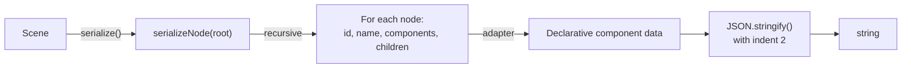
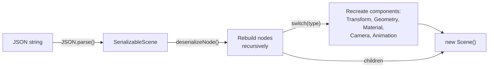
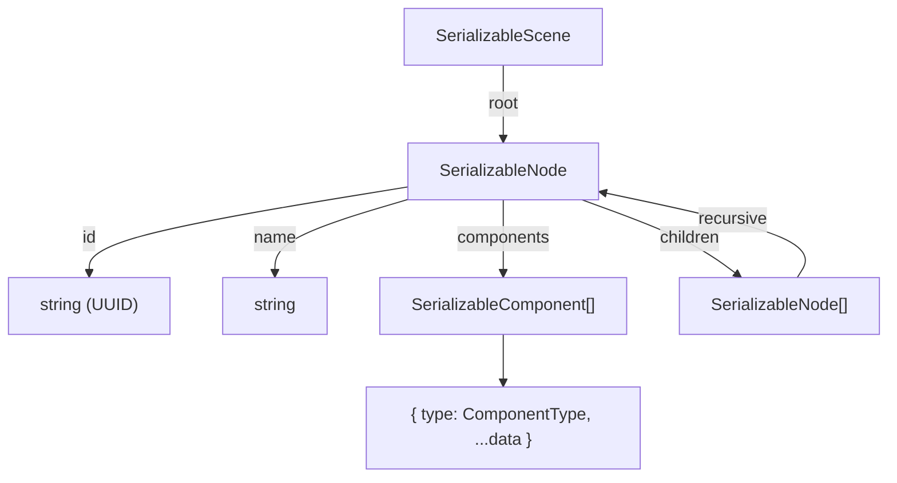

# シリアライゼーション

Oroya Animateには、シーン全体を保存・読み込みできるJSONシリアライゼーションシステムが含まれています。ビジュアルエディター、コラボレーション、シーンのバージョン管理の基盤となります。

---

## 目次

- [シーンをシリアライズする](#シーンをシリアライズする)
- [シーンをデシリアライズする](#シーンをデシリアライズする)
- [JSON形式](#json形式)
- [サポートされているコンポーネント](#サポートされているコンポーネント)
- [ユースケース](#ユースケース)
- [制限事項](#制限事項)

---

## シーンをシリアライズする

`serialize`関数は、シーングラフ全体をフォーマットされたJSON文字列に変換します：

```typescript
import { Scene, Node, createBox, Material, serialize } from '@joroya/core';

const scene = new Scene();

const cube = new Node('hero-cube');
cube.addComponent(createBox(2, 2, 2));
cube.addComponent(new Material({ color: { r: 1, g: 0.5, b: 0 } }));
cube.transform.position = { x: 3, y: 0, z: -1 };
scene.add(cube);

const json = serialize(scene);
console.log(json);
```

### シリアライゼーションフロー



---

## シーンをデシリアライズする

`deserialize`関数は、JSON文字列から機能する`Scene`を再構築します：

```typescript
import { deserialize } from '@joroya/core';

const restoredScene = deserialize(json);

const found = restoredScene.findNodeByName('hero-cube');
console.log(found?.transform.position); // { x: 3, y: 0, z: -1 }
```

対応するコンポーネントを復元したシーンをレンダラーにマウントできます。以下の制限事項も確認してください：

```typescript
import { ThreeRenderer } from '@joroya/renderer-three';

const renderer = new ThreeRenderer({ canvas, width, height });
renderer.mount(restoredScene);
renderer.render();
```

### デシリアライゼーションフロー



---

## JSON形式

### 一般的な構造



### 完全な出力例

```json
{
  "root": {
    "id": "550e8400-e29b-41d4-a716-446655440000",
    "name": "root",
    "components": [
      {
        "type": "Transform",
        "position": { "x": 0, "y": 0, "z": 0 },
        "rotation": { "x": 0, "y": 0, "z": 0, "w": 1 },
        "scale": { "x": 1, "y": 1, "z": 1 },
        "localMatrix": [1,0,0,0, 0,1,0,0, 0,0,1,0, 0,0,0,1],
        "worldMatrix": [1,0,0,0, 0,1,0,0, 0,0,1,0, 0,0,0,1],
        "isDirty": true
      }
    ],
    "children": [
      {
        "id": "6ba7b810-9dad-11d1-80b4-00c04fd430c8",
        "name": "hero-cube",
        "components": [
          {
            "type": "Transform",
            "position": { "x": 3, "y": 0, "z": -1 },
            "rotation": { "x": 0, "y": 0, "z": 0, "w": 1 },
            "scale": { "x": 1, "y": 1, "z": 1 },
            "localMatrix": [1,0,0,0, 0,1,0,0, 0,0,1,0, 3,0,-1,1],
            "worldMatrix": [1,0,0,0, 0,1,0,0, 0,0,1,0, 3,0,-1,1],
            "isDirty": false
          },
          {
            "type": "Geometry",
            "definition": {
              "type": "Box",
              "width": 2,
              "height": 2,
              "depth": 2
            }
          },
          {
            "type": "Material",
            "definition": {
              "color": { "r": 1, "g": 0.5, "b": 0 }
            }
          }
        ],
        "children": []
      }
    ]
  }
}
```

### 内部インターフェース

| インターフェース | フィールド | 説明 |
|------------------|------------|------|
| `SerializableScene` | `root: SerializableNode` | トップレベルコンテナ |
| `SerializableNode` | `id`, `name`, `cssClass?`, `cssId?`, `components[]`, `children[]` | ノードのフラット表現 |
| `SerializableComponent` | `type: ComponentType`, `+ ...data` | タイプとデータを持つ各コンポーネント |

---

## サポートされているコンポーネント

対応する宣言的データだけを保存します。実行時フィールド、コールバック、ノード参照、バックエンドのインスタンスは、イベントデータ内も含めて除外します。バインド済み Animator も安全に保存できます。

| コンポーネント | デシリアライズ |
| --- | --- |
| `Transform` | 新しい `Transform` にフィールドを復元 |
| `Geometry`, `Material`, `Camera`, `Interactive`, `Light`, `Environment` | `definition` から再構築 |
| `RigidBody`, `Collider`, `PostProcessing`, `ParticleSystem` | 定義を再構築。バックエンドの実行状態は別途作成 |
| `Animator`, `AudioListener`, `AudioSource`, `Skin` | 定義を再構築。再生セッションと読み込み済みリソースは保存しない |
| `Animation` | `animations` から再構築 |
| `InstancedMesh`, `Script`, 未知の型 | スキップ。アプリケーションのアダプターが必要 |

### Typed arrays

`Float32Array`、`Uint8Array`、`Uint16Array`、`Uint32Array` は `{ __typedArray, base64 }` として保存し、元の配列型に復元します。アニメーショントラックとバッファジオメトリに利用できますが、`InstancedMesh` コンポーネント自体は復元されません。他の typed array 型はこの形式では未対応です。

```ts
import { typedArrayReplacer, typedArrayReviver } from '@joroya/core';

const encoded = JSON.stringify({ values: new Float32Array([0, 1, 2]) }, typedArrayReplacer);
const decoded = JSON.parse(encoded, typedArrayReviver);
console.log(decoded.values instanceof Float32Array); // true
```

### 保持されるデータ

ルートを含む全ノードの ID、名前、親子関係、transform、`cssClass`、`cssId` と対応するコンポーネント定義を保持します。`addComponent()` が `component.node` を再設定し、描画時にワールド行列を再計算します。

保存したルートの ID、名前、CSS 情報、transform と対応するコンポーネントを復元します。Scene(root?: Node) は親のないルートを受け取り、引数なしのコンストラクターも利用できます。古い JSON に Transform がない場合はデフォルトを作成します。

---

## ユースケース

### localStorageでの永続化

```typescript
function saveScene(scene: Scene): void {
  const json = serialize(scene);
  localStorage.setItem('oroya-scene', json);
}

function loadScene(): Scene | null {
  const json = localStorage.getItem('oroya-scene');
  if (!json) return null;
  return deserialize(json);
}
```

### ダウンロード可能なファイルとしてエクスポート

```typescript
function downloadScene(scene: Scene, filename: string): void {
  const json = serialize(scene);
  const blob = new Blob([json], { type: 'application/json' });
  const url = URL.createObjectURL(blob);

  const a = document.createElement('a');
  a.href = url;
  a.download = filename;
  a.click();

  URL.revokeObjectURL(url);
}

downloadScene(scene, 'my-scene.json');
```

### ファイルからインポート

```typescript
async function importScene(file: File): Promise<Scene> {
  const text = await file.text();
  return deserialize(text);
}

// input[type=file] の場合
input.addEventListener('change', async (e) => {
  const file = (e.target as HTMLInputElement).files?.[0];
  if (file) {
    const scene = await importScene(file);
    renderer.mount(scene);
  }
});
```

### サーバーサイドレンダリング

```typescript
// シリアライズされたシーンを受け取り、サーバーでSVGにレンダリング
import { deserialize } from '@joroya/core';
import { renderToSVG } from '@joroya/renderer-svg';

function handleRequest(jsonBody: string): string {
  const scene = deserialize(jsonBody);
  return renderToSVG(scene, { width: 800, height: 600, dt: 0 });
}
```

### Gitでのバージョン管理

シーンを`.json`として保存すると、以下が可能になります：

```
scenes/
├── level-01.json    → gitでバージョン管理
├── level-02.json
└── hub-world.json
```

Gitの差分で変更内容が正確に表示されます：

```diff
 "name": "hero-cube",
 "components": [
   {
     "type": "Transform",
-    "position": { "x": 3, "y": 0, "z": -1 },
+    "position": { "x": 5, "y": 2, "z": -1 },
```

---

## 制限事項

| 制限 | 影響と対処 |
| --- | --- |
| 実行時コールバック | `onUpdate` とイベントリスナーを読み込み後に再登録 |
| インスタンシングと独自コンポーネント | `InstancedMesh`、`Script`、未知の型はスキップ。アダプターで復元 |
| 子孫の ID を保持 | 二度読み込むと ID が重複する場合あり。独立コピーには新しいノードを作成 (`id` は readonly) |
| スキーマ検証なし | 不正な JSON やデータ形状は例外を発生させる場合あり。アプリケーション側で検証 |
| 外部リソース | URI と定義を保存。テクスチャ、音声、モデルのファイルや物理の実行状態は保存しない |

内部アダプターは transform、コンポーネント定義と SVG アニメーションだけを保存します。バインド済み、再生中、停止中の Animator もシリアライズできます。mixer、コールバック、ノード参照とバックエンドのリソースは除外します。クリップ定義は復元しますが、再生の正確な時点は復元しません。
