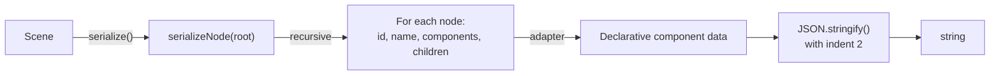
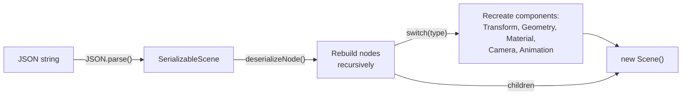
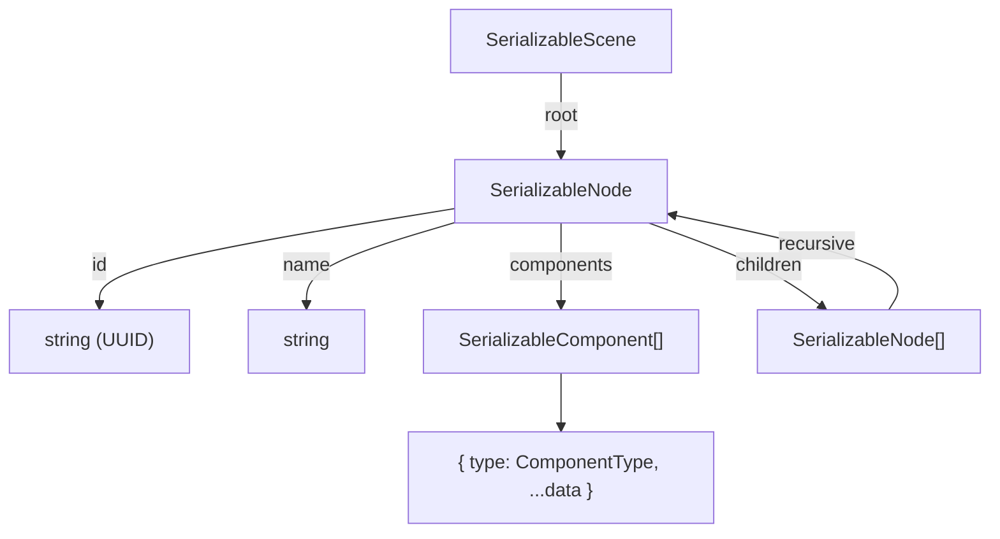

# Serialization

Oroya Animate includes a JSON serialization system that allows saving and loading scene definitions. It is the foundation for visual editors, collaboration, and scene versioning.

---

## Table of contents

- [Serialize a scene](#serialize-a-scene)
- [Deserialize a scene](#deserialize-a-scene)
- [JSON format](#json-format)
- [Supported components](#supported-components)
- [Use cases](#use-cases)
- [Limitations](#limitations)

---

## Serialize a scene

The `serialize` function converts the entire scene graph to a formatted JSON string:

```typescript
import { Scene, Node, createBox, Material, serialize } from '@joroya/core';

const scene = new Scene();

const cube = new Node('hero-cube');
cube.addComponent(createBox(2, 2, 2));
cube.addComponent(new Material({ color: { r: 1, g: 0.5, b: 0 } }));
cube.transform.position = { x: 3, y: 0, z: -1 };
scene.add(cube);

const json = serialize(scene);
console.log(json);
```

### Serialization flow



---

## Deserialize a scene

The `deserialize` function reconstructs a functional `Scene` from a JSON string:

```typescript
import { deserialize } from '@joroya/core';

const restoredScene = deserialize(json);

const found = restoredScene.findNodeByName('hero-cube');
console.log(found?.transform.position); // { x: 3, y: 0, z: -1 }
```

The restored scene is fully functional and can be mounted on any renderer:

```typescript
import { ThreeRenderer } from '@joroya/renderer-three';

const renderer = new ThreeRenderer({ canvas, width, height });
renderer.mount(restoredScene);
renderer.render();
```

### Deserialization flow



---

## JSON format

### General structure



### Complete output example

```json
{
  "root": {
    "id": "550e8400-e29b-41d4-a716-446655440000",
    "name": "root",
    "components": [
      {
        "type": "Transform",
        "position": { "x": 0, "y": 0, "z": 0 },
        "rotation": { "x": 0, "y": 0, "z": 0, "w": 1 },
        "scale": { "x": 1, "y": 1, "z": 1 },
        "localMatrix": [1,0,0,0, 0,1,0,0, 0,0,1,0, 0,0,0,1],
        "worldMatrix": [1,0,0,0, 0,1,0,0, 0,0,1,0, 0,0,0,1],
        "isDirty": true
      }
    ],
    "children": [
      {
        "id": "6ba7b810-9dad-11d1-80b4-00c04fd430c8",
        "name": "hero-cube",
        "components": [
          {
            "type": "Transform",
            "position": { "x": 3, "y": 0, "z": -1 },
            "rotation": { "x": 0, "y": 0, "z": 0, "w": 1 },
            "scale": { "x": 1, "y": 1, "z": 1 },
            "localMatrix": [1,0,0,0, 0,1,0,0, 0,0,1,0, 3,0,-1,1],
            "worldMatrix": [1,0,0,0, 0,1,0,0, 0,0,1,0, 3,0,-1,1],
            "isDirty": false
          },
          {
            "type": "Geometry",
            "definition": {
              "type": "Box",
              "width": 2,
              "height": 2,
              "depth": 2
            }
          },
          {
            "type": "Material",
            "definition": {
              "color": { "r": 1, "g": 0.5, "b": 0 }
            }
          }
        ],
        "children": []
      }
    ]
  }
}
```

### Internal interfaces

| Interface | Fields | Description |
|-----------|--------|-------------|
| `SerializableScene` | `root: SerializableNode` | Top-level container |
| `SerializableNode` | `id`, `name`, `cssClass?`, `cssId?`, `components[]`, `children[]` | Flat representation of a node |
| `SerializableComponent` | `type: ComponentType`, `+ ...data` | Each component with its type and data |

---

## Supported components

`serialize()` uses typed internal adapters to save declarative definitions, TRS values and SVG animations. It excludes runtime state, callbacks, node references and backend instances, including references nested in event data. Bound Animator components can be saved safely.

| Component | Deserialization |
| --- | --- |
| `Transform` | Restores position, quaternion and scale; cached matrices are ignored |
| `Geometry`, `Material`, `Camera`, `Interactive`, `Light`, `Environment` | Reconstructs from `definition` |
| `RigidBody`, `Collider`, `PostProcessing`, `ParticleSystem` | Reconstructs definitions; backend runtime is recreated separately |
| `Animator`, `AudioListener`, `AudioSource`, `Skin` | Reconstructs definitions; playback and loaded resources are not a saved session |
| `Animation` | Reconstructs from `animations` |
| `InstancedMesh`, `Script`, unknown component types | Skipped; restore through application adapters |

### Typed arrays

`Float32Array`, `Uint8Array`, `Uint16Array`, and `Uint32Array` are encoded as `{ __typedArray, base64 }` and restored to their original array type. This supports animation tracks and buffer geometry. It does not make an `InstancedMesh` component restorable. Other typed-array classes are not supported by this encoding.

```ts
import { typedArrayReplacer, typedArrayReviver } from '@joroya/core';

const encoded = JSON.stringify({ values: new Float32Array([0, 1, 2]) }, typedArrayReplacer);
const decoded = JSON.parse(encoded, typedArrayReviver);
console.log(decoded.values instanceof Float32Array); // true
```

### What is preserved

Node IDs (including the root), names, parent-child relationships, transforms, `cssClass`, `cssId`, and supported component definitions are preserved. `component.node` is reattached by `addComponent()`. World matrices are recomputed on rendering.

The saved root is reconstructed with its ID, name, CSS metadata, transform and supported components. Scene(root?: Node) accepts a parentless root; the no-argument constructor remains supported. Legacy JSON without a Transform receives the default Transform.

---

## Use cases

### localStorage persistence

```typescript
function saveScene(scene: Scene): void {
  const json = serialize(scene);
  localStorage.setItem('oroya-scene', json);
}

function loadScene(): Scene | null {
  const json = localStorage.getItem('oroya-scene');
  if (!json) return null;
  return deserialize(json);
}
```

### Export as downloadable file

```typescript
function downloadScene(scene: Scene, filename: string): void {
  const json = serialize(scene);
  const blob = new Blob([json], { type: 'application/json' });
  const url = URL.createObjectURL(blob);

  const a = document.createElement('a');
  a.href = url;
  a.download = filename;
  a.click();

  URL.revokeObjectURL(url);
}

downloadScene(scene, 'my-scene.json');
```

### Import from file

```typescript
async function importScene(file: File): Promise<Scene> {
  const text = await file.text();
  return deserialize(text);
}

// With input[type=file]
input.addEventListener('change', async (e) => {
  const file = (e.target as HTMLInputElement).files?.[0];
  if (file) {
    const scene = await importScene(file);
    renderer.mount(scene);
  }
});
```

### Server-side rendering

```typescript
// Receive serialized scene, render to SVG on server
import { deserialize } from '@joroya/core';
import { renderToSVG } from '@joroya/renderer-svg';

function handleRequest(jsonBody: string): string {
  const scene = deserialize(jsonBody);
  return renderToSVG(scene, { width: 800, height: 600, dt: 0 });
}
```

### Git versioning

Saving scenes as `.json` allows:

```
scenes/
├── level-01.json    → Versioned with git
├── level-02.json
└── hub-world.json
```

Git diffs show exactly what changed:

```diff
 "name": "hero-cube",
 "components": [
   {
     "type": "Transform",
-    "position": { "x": 3, "y": 0, "z": -1 },
+    "position": { "x": 5, "y": 2, "z": -1 },
```

---

## Limitations

| Limitation | Impact and workaround |
| --- | --- |
| Runtime callbacks | `onUpdate` and event handlers are not persisted; register them again after loading |
| Instancing and custom components | `InstancedMesh`, `Script`, and unknown types are skipped by the reviver; restore with an adapter |
| IDs are preserved on all nodes | Importing the same scene twice can create duplicate IDs; create new nodes for independent copies (`id` is readonly) |
| Schema validation | `validateSceneJSON()` checks structure, IDs, numeric definitions and supported buffers before construction; errors throw `SceneValidationError` |
| External resources | JSON stores resource URIs and definitions, not texture/audio/model files or live physics state |

Internal adapters save transforms, component definitions and SVG animations. Bound, playing and paused Animator components are safe to serialize; mixers, callbacks, node references and backend resources are excluded. Clip definitions survive loading, but the exact playback instant is not restored.

## 1.2

[Capabilities, diagnostics and acceptance](/docs/stability-1.2) describe the current rendering and persistence contracts.
